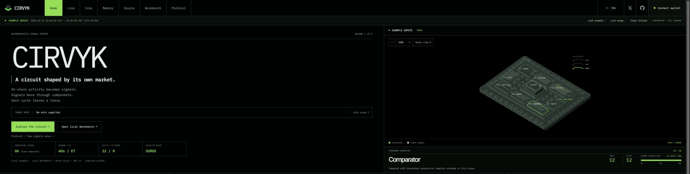
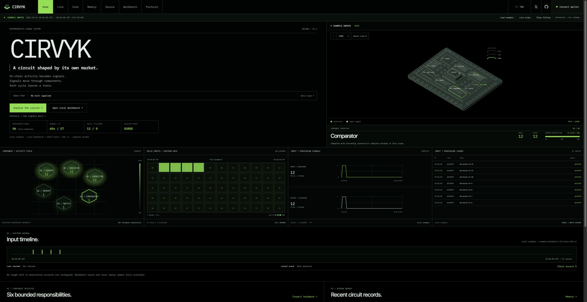
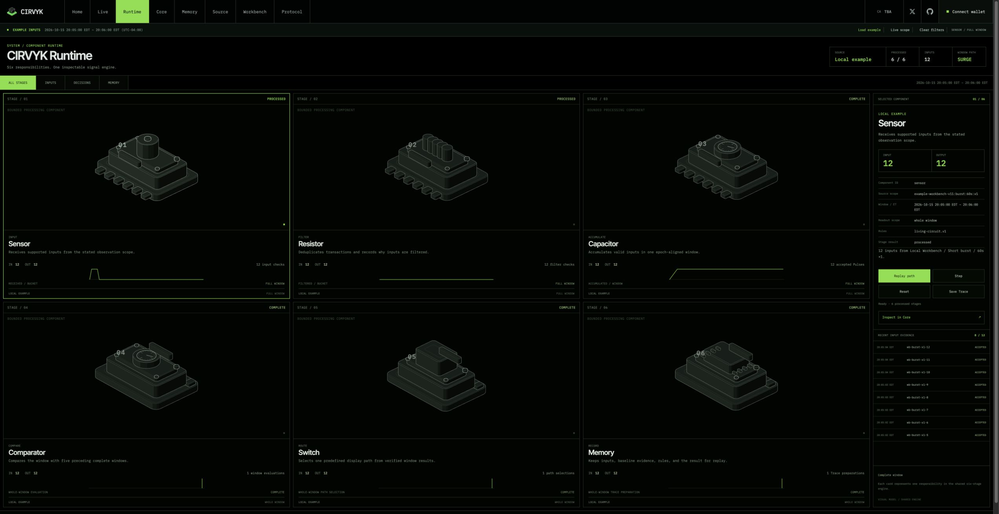
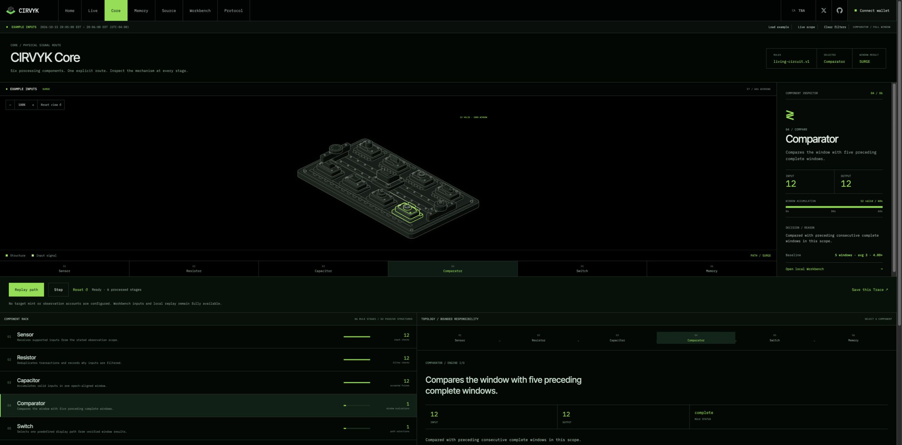

# CIRVYK



**A circuit that remembers.**

CIRVYK is a circuit-based interface for observing a defined slice of Solana token activity. It represents incoming events as signals moving through visible processing stages, connecting individual inputs to changes in circuit state.

Inspect a component, follow a signal through its path, and revisit the Trace produced by a processing window.

[Website](https://www.cirvyk.xyz/#home) · [Protocol](docs/protocol.md) · [Development](docs/development.md)

## Overview

The reader checks finalized transactions involving explicitly configured Solana accounts and looks for evidence concerning a target mint. A shared browser store feeds those inputs into a deterministic engine. Circuit components, instruments and event details expose the same selected result.

This repository contains the complete application: native browser ES modules, HTML, CSS, SVG artwork, the Node observation API, tests, configuration and documentation. No frontend framework or bundle compiler is required. Without live configuration, the interface starts with explicitly labeled, reproducible local examples.



*Local example inputs, not current chain activity. Displayed dates and times use US Eastern time.*

## Interface

| View | Purpose | Main interaction |
| --- | --- | --- |
| Home | Shared system overview | Select a component or processing interval |
| Live | Scoped input inspection | Filter events and inspect their evidence |
| Runtime | Component cabinet and shared processing evidence | Inspect six detailed modules and replay the selected Trace |
| Core | Circuit structure and stage details | Pan, zoom, select a component and replay a path |
| Memory | Browser-local Trace history | Save, reopen, import or export a record |
| Source | Actual reviewed public files | Browse files, inspect code and copy content |
| Workbench | Local signal laboratory | Change example parameters and execute or step through stages |
| Protocol | Technical manual | Read rules, responsibilities and data boundaries |

Core retains the `#circuit` route. Source remains an internal reader; the header GitHub icon opens this repository separately.



*The cabinet uses the selected example, historical record or observed window. Component metrics describe processing activity, not independent agents or hardware telemetry.*

## Signal processing

```text
Observe → Filter → Accumulate → Compare → Route → Record
```

| Component | Implemented responsibility |
| --- | --- |
| Sensor | Normalize and order supplied inputs |
| Resistor | Check eligibility and retain rejection reasons |
| Capacitor | Accumulate accepted inputs in one window |
| Comparator | Evaluate preceding complete-window evidence |
| Switch | Choose QUIET, FLOW or SURGE from the result |
| Memory | Prepare the inspectable record and replay evidence |

These stages belong to `finalizeWindow()` in [engine.js](public/modules/engine.js). Their visual components are not independent services or AI agents.

Live event identity is `signature:mint`; example identity is a non-empty input ID. Duplicate inputs are filtered. Default windows span 60 seconds, include their start and exclude their end. A baseline requires five consecutive preceding complete windows with matching scope and rules.

A final empty window selects QUIET. SURGE requires at least ten accepted inputs and at least twice the baseline average; other non-empty final windows select FLOW. Accumulating or incomplete windows have no final path. Missing coverage is not treated as a verified zero. Thresholds are defined in [rules.js](public/config/rules.js).

## Traces and replay

A `circuit.trace.v1` record retains normalized inputs, filtering results, source identity, window bounds, exact rules, baseline evidence, stage outputs and the selected path. Import validation reruns the engine and compares the result. Reproduction depends on the saved rules and baseline, not just the final count.

Memory uses browser local storage, with limits of 30 records and 3 MiB. JSON import/export preserves the record; PNG Snapshot exports its visual summary. Historical and example contexts stay distinct from current local observation. Replay does not add live inputs or establish independent chain provenance.



*Local example Trace. The selected component, inspector and instruments share the same record.*

## Getting started

Use Node.js 22 or 24 and pnpm 10.28.0. The repository pins pnpm and includes its lockfile.

```sh
git clone https://github.com/theovarne/CIRVYK.git
cd CIRVYK
pnpm install --frozen-lockfile
pnpm test
pnpm build
pnpm dev
```

Open `http://127.0.0.1:5175`. `pnpm dev` serves `public/` and both API routes on loopback. `pnpm test` runs the existing Node test suites. `pnpm build` validates reviewed file hashes, configuration and the generated Source manifest; it does not compile assets. The committed `public/` files are the frontend output, while observation also requires the API source.

For a reproducible example, open Workbench and choose Short burst, a 60-second window and one batch: twelve inputs, zero filtered, baseline average three and SURGE. Execute, inspect a stage, save the Trace and reopen it in Memory.

## Configuration

Examples need no credentials. Live observation requires a server-side target and explicit accounts.

| Setting | Requirement and scope |
| --- | --- |
| `CIRCUIT_MINT` | Required for live mode; public target mint |
| `CIRCUIT_OBSERVED_ACCOUNTS` | Required for live mode; up to four public accounts, separated by commas or whitespace |
| `CIRCUIT_NETWORK` | Optional; `mainnet-beta` by default, also `devnet` or `testnet` |
| `SOLANA_RPC_URL` | Optional, server-only HTTPS provider override |
| `SOLANA_RPC_API_KEY` | Optional, server-only bearer credential |
| `PORT` | Optional local server port; default `5175` |

[.env.example](.env.example) contains empty configuration fields. The server does not automatically load `.env`; export values or explicitly run `node --env-file=.env scripts/dev.mjs`. Keep real credentials outside Git. `/api/config` exposes the observation scope while omitting the provider URL and key.

Public identity and project links live in [site.js](public/config/site.js). Changing website branding does not rename compatible schemas, storage keys or routes.

## Data and execution boundaries

Observation is bounded to configured accounts and parser-supported Activity/Transfer evidence, not complete market coverage or buy/sell classification. One shared reader checks approximately every fifteen seconds while the browser is visible. It pauses when hidden; closing the browser stops collection. There is no backend Trace database.

Wallet Standard and recognized Solana extensions supply a public address only after user approval. That address filters already observed relationships; it does not prove ownership or trading direction. CIRVYK reads activity and exposes processing state. It does not execute trades or request token approvals.

Human-readable time uses `America/New_York`, selecting EDT or EST for each timestamp. Stored epochs, ISO exchange fields and UTC-aligned processing boundaries remain stable for replay compatibility.

## Development and documentation

- [Architecture](docs/architecture.md): layers, shared state and rendering relationships.
- [Development](docs/development.md): setup, checks, configuration and reproduction steps.
- [Data model](docs/data-model.md): inputs, windows, Trace schema and Memory exchange.
- [Deployment](DEPLOYMENT.md): existing Vercel configuration and API behavior.

```text
public/       Browser application, styles, configuration and artwork
api/          Direct Node observation endpoints
lib/          Shared read-only server adapter and Solana reader
scripts/      Local server, metadata and source-integrity tooling
tests/        Engine, API and interface regression tests
docs/         Technical documentation and application captures
```

## Attribution and license

[NOTICE.md](NOTICE.md) preserves circuit-artwork, font and third-party mark attribution. [Wallet asset sources](docs/wallet-assets.md) document provider and social icons. No project-wide license grant has been selected; public source availability does not itself establish an open-source license or unrestricted rights to inherited artwork.
